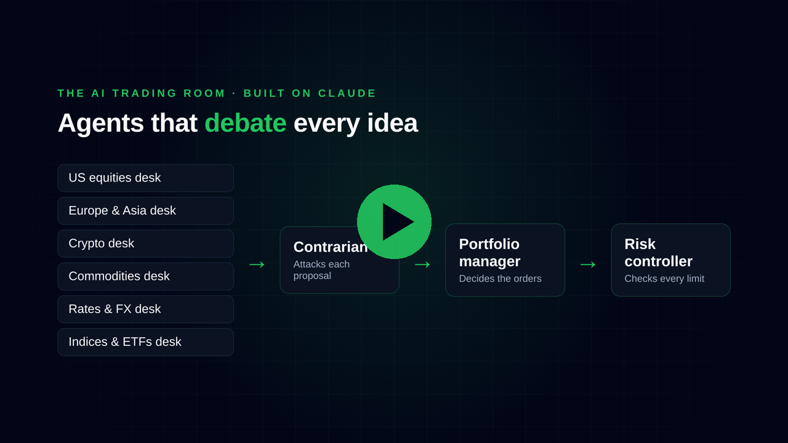
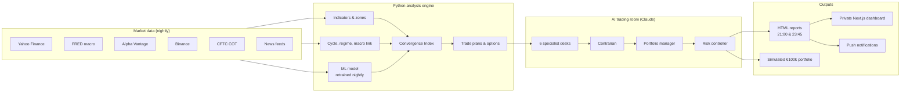
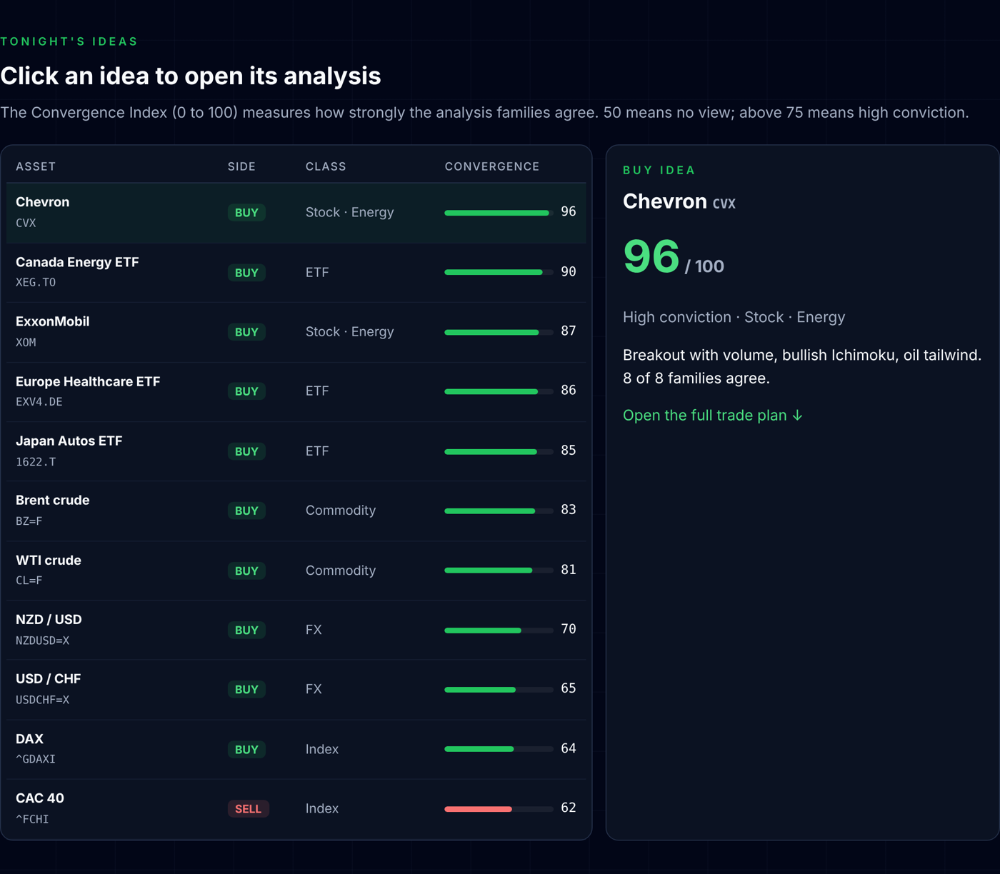
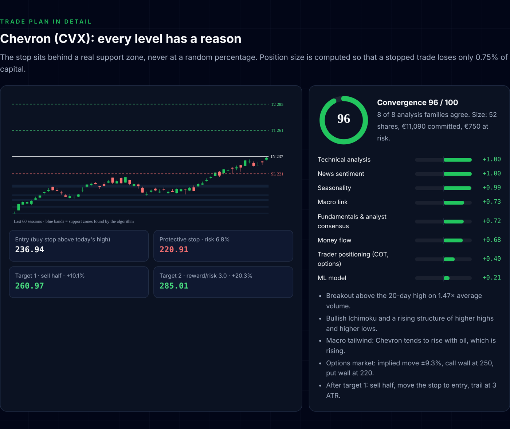
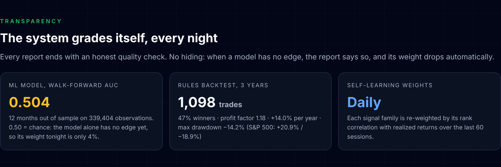

# RADAR — AI Multi-Agent Market Analysis

**A personal project that analyzes ~650 financial assets every night with machine learning and a team of AI agents, then produces risk-controlled trade plans and runs a simulated portfolio on real prices.**

**[▶ Live demo](https://radar-demo-delta.vercel.app)** · **[▶ Demo video (1 min 50)](https://radar-demo-delta.vercel.app/video.html)** · Built by [Mordehai Levy](https://www.linkedin.com/in/mordehailevy)

> **About this repository:** RADAR runs privately on my machine and its source code is not public: it holds API keys and personal settings. This showcase repository documents the architecture, the design decisions and real outputs. I am happy to walk through the code in an interview.

---

## What it does

Every evening, without any manual action, RADAR:

1. **Collects real market data** on ~650 assets: S&P 500, Nasdaq 100 and CAC 40 stocks, major indices, 16 commodity futures, 9 cryptocurrencies, rates, currencies, volatility, and G7 + China country and sector ETFs.
2. **Reads the economy:** business-cycle phase (yield curve, Sahm rule, unemployment, credit, industry, inflation), risk-on / risk-off regime, US presidential cycle since 1950.
3. **Reads trader positioning:** CFTC COT futures positioning, put/call ratios, skew, implied moves and option "walls", crypto funding, open interest and long/short ratios, futures curve structure (contango / backwardation).
4. **Tracks money flow and macro sensitivity:** Chaikin Money Flow, OBV, MFI, unusual volume, sector rotation, market breadth, and each asset's sensitivity to real rates, the dollar, oil, credit and the VIX.
5. **Retrains a machine-learning model** (scikit-learn gradient boosting) every night, validated walk-forward on 12 months of unseen data. Signal-family weights are recalculated daily from their recent effectiveness.
6. **Scores every candidate** with technical analysis (moving averages, RSI, MACD, ADX, Ichimoku, Supertrend, Bollinger/Keltner, candlesticks, support/resistance zones, volume profile, Fibonacci, Dow structure), fundamentals, analyst consensus and revisions, insider activity and financial news.
7. **Computes the Convergence Index (0–100):** how many independent analysis families point the same way. An idea is proposed only above 62; above 75 is high conviction.
8. **Builds a trade plan:** entry, stop behind a real market zone, target 1 (sell half), target 2, and a position size that risks **0.75% of capital**. Option strategies (spreads, collars, covered calls…) come with cost, max gain, max loss and probability of profit.
9. **Runs the AI trading room** (see below), then publishes the reports and updates a **simulated €100,000 portfolio**, where orders only fill if the real price is reached (stops, gaps, fees and EUR/USD conversion included), benchmarked against the S&P 500 and CAC 40.

## Architecture

### The AI trading room

The best candidates go to a team of AI agents built on **Claude**, each with its own system prompt and role:

| Agent | Role | Model |
|-------|------|-------|
| 6 specialist desks | US equities, Europe & Asia, crypto, commodities, rates & FX, indices & ETFs: each desk pitches its best ideas | Sonnet |
| Contrarian | Attacks every proposal and looks for what could go wrong | Sonnet |
| Portfolio manager | Decides which ideas become orders, given the existing book | Opus |
| Risk controller | Checks exposure, concentration and limits | Sonnet |

A lessons module reviews past decisions and feeds what it learned back into the next session. Separate agents write the intraday strategy note, the evening summary and the press review.

## Screenshots

**Tonight's ideas, ranked by the Convergence Index**

**A full trade plan: every level has a reason**

**The system grades itself every night**

## Risk rules

| Rule | Value |
|------|-------|
| Simulated capital | €100,000 |
| Maximum loss per trade | 0.75% of capital |
| Maximum open positions | 10 |
| Maximum per class (stocks / indices / commodities / crypto) | 7 / 2 / 3 / 2 |
| Trade horizon | 15 sessions |

## Transparency: honest model evaluation

Every report ends with a quality check, even when the numbers are not flattering:

- **ML model:** walk-forward AUC of **0.504** on 339,404 observations (0.50 = chance). The model alone has no edge yet, so the daily re-weighting gives it only a small weight.
- **Rules backtest (3 years, 1,098 trades):** 47% winners, profit factor 1.18, +14.0% per year, max drawdown −14.2%, versus the S&P 500 at +20.9% per year and −18.9%.
- Each signal family is re-weighted every night by its rank correlation (IC) with realized returns over the last 60 sessions.

The goal is not to "beat the market" with a black box, but to build a disciplined, measurable decision-support system and to know exactly how good it is.

## Engineering & operations

- **Fully automated:** scheduled macOS jobs (LaunchAgents) produce a pre-report at 21:00 and an official report at 23:45 (Israel time), after Wall Street closes, plus AI summaries at 21:15 and 23:55.
- **Private dashboard:** Next.js app on Vercel with email/password authentication, invite-based access and an "analyze now" button that the local engine picks up within a minute.
- **Notifications:** push notification for every report.
- **Safeguards:** a manual kill switch that stops all AI activity instantly, activity logs to investigate any incident, 40 automated tests, secrets kept out of Git with an encrypted backup.
- **Cost-aware:** model choice per agent (Sonnet for desks, Opus only where judgment matters most).

## Tech stack

**Engine:** Python · pandas · NumPy · SciPy · scikit-learn · yfinance · feedparser
**Data:** Yahoo Finance · FRED · Alpha Vantage · Binance · CFTC · financial news feeds
**AI:** Claude (Sonnet & Opus), multi-agent prompts, lessons memory
**Web:** Next.js · React · Tailwind CSS · Vercel
**Ops:** macOS LaunchAgents · ntfy push notifications · automated tests

## Live demo

The [interactive demo](https://radar-demo-delta.vercel.app) replays one real evening (session of 30 October 2026) in English: the market regime, the ranked ideas, the full Chevron trade plan, the AI trading room and the quality check. The demo is a static page ([`demo/index.html`](demo/index.html)); it does not run the engine. The demo video is a motion-design piece built with Remotion; its source is in [`video/`](video/).

---

RADAR is a personal decision-support project. Its portfolio is simulated: no real money is traded. Nothing here is investment advice.

**Author:** Mordehai Levy · Full-stack & AI developer, Tel Aviv · [GitHub](https://github.com/mordehailevy) · [LinkedIn](https://www.linkedin.com/in/mordehailevy)
